# RaspberryPi4Gadget

A pocket-sized IT helpdesk tool built from a Raspberry Pi 4 and a 3.5" touch screen.

At its core is **PiLauncher**, a touch launcher written in Python/pygame. It starts at boot, draws straight to the
framebuffer (no desktop environment), reads the touch panel directly, and updates itself from this repository's
GitHub releases. On top of it run the apps: a wired **Network tester** that tells you which switch port a wall socket is
patched to, a **Wi-Fi tester** for signal, channels and roaming problems, and a **Settings** app.

> The user interface is in Italian. Screenshots below are rendered from the real launcher code with sample data.

<p align="center">
  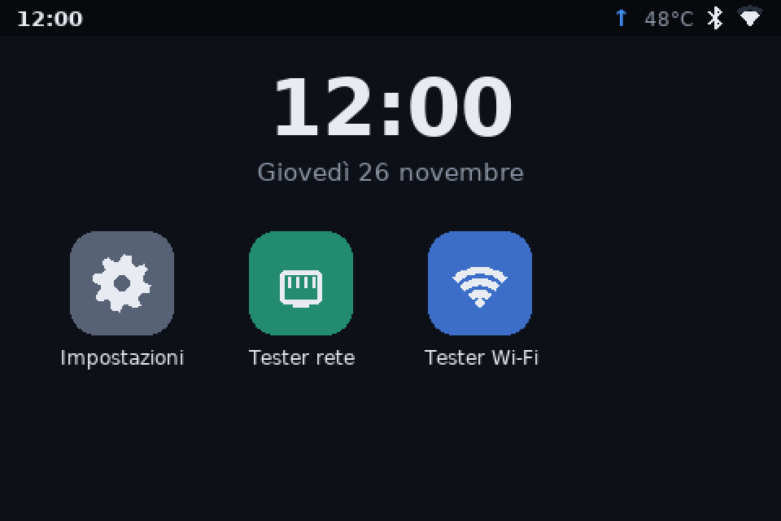
  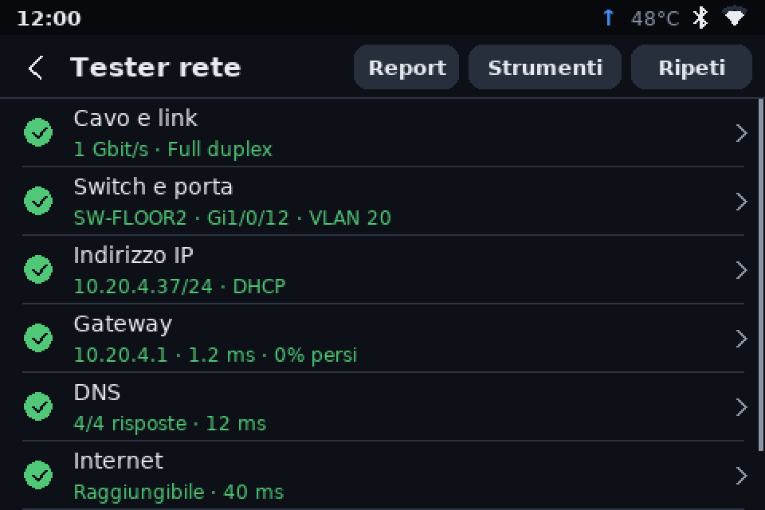
</p>

## Contents
- [Hardware](#hardware)
- [Installation](#installation)
- [The launcher](#the-launcher)
- [Apps](#apps)
  - [Settings](#settings)
  - [Network tester](#network-tester)
  - [Wi-Fi tester](#wi-fi-tester)
- [Over-the-air updates](#over-the-air-updates)
- [Useful commands](#useful-commands)
- [Repository layout](#repository-layout)
- [Writing an app](#writing-an-app)

## Hardware

| Part | Details |
|---|---|
| Board | Raspberry Pi 4 |
| Screen | Kuman 3.5" SPI HAT, 320×480, ILI9486 controller (DRM driver) |
| Touch | Resistive, ADS7846 / XPT2046 |
| OS | Raspberry Pi OS based on Debian 13 (trixie), booting to console |
| Power | 5 V / 3 A supply or power bank |

### Screen setup
Add these lines at the end of `/boot/firmware/config.txt`, under `[all]`:
```
dtparam=spi=on
dtoverlay=piscreen,drm,speed=16000000,rotate=270
```
With the DRM driver the `rotate` parameter has no effect: the panel stays 320×480 portrait and the launcher rotates
the image itself (Settings → Schermo e touch).

Boot to the console instead of the desktop:
```bash
sudo raspi-config nonint do_boot_behaviour B1
```

## Installation

On the Raspberry Pi, over SSH:
```bash
curl -fsSL https://raw.githubusercontent.com/raxp122/RaspberryPi4Gadget/main/install.sh | bash
```

The installer:
1. installs the required packages (`python3-pygame`, `network-manager`, `bluez`, `fonts-dejavu-core`, `ethtool`,
   `iw`, `ieee-data`, …);
2. downloads the latest release, verifies its SHA-256 checksum and unpacks it into `/opt/pilauncher`;
3. imports the touch calibration and settings from an older install in `~/pilauncher`, if there is one;
4. creates the `pilauncher.service` systemd unit (starts at boot, restarts on failure) and disables the text login
   on tty1. SSH keeps working.

On first start, if no calibration exists, the launcher shows five crosshairs to tap.

To try a branch before it is merged:
```bash
curl -fsSL https://raw.githubusercontent.com/raxp122/RaspberryPi4Gadget/<branch>/install.sh | bash -s -- --branch <branch>
```

## The launcher

- **Home**: a large clock, the date and a grid of apps. Apps are discovered automatically from the `apps/` folder.
- **Status bar**: time, Wi-Fi signal, Bluetooth, CPU temperature, `⚡` when the power supply is too weak and `↑` when
  an update is available. Tapping the status bar always takes you back home.
- **Touch**: raw evdev input with an affine calibration, median filtering, taps and drag-to-scroll lists.
- **Keyboards**: an on-screen keyboard, plus USB and Bluetooth keyboards (Italian layout; Enter confirms,
  Esc goes back).
- **Display**: the launcher draws a 480×320 landscape surface, rotates it and writes only the changed rows to
  `/dev/fb0` in RGB565. The SPI panel manages about 6 full-screen frames per second, so the UI avoids full-screen
  animation.

## Apps

### Settings

<p align="center">
  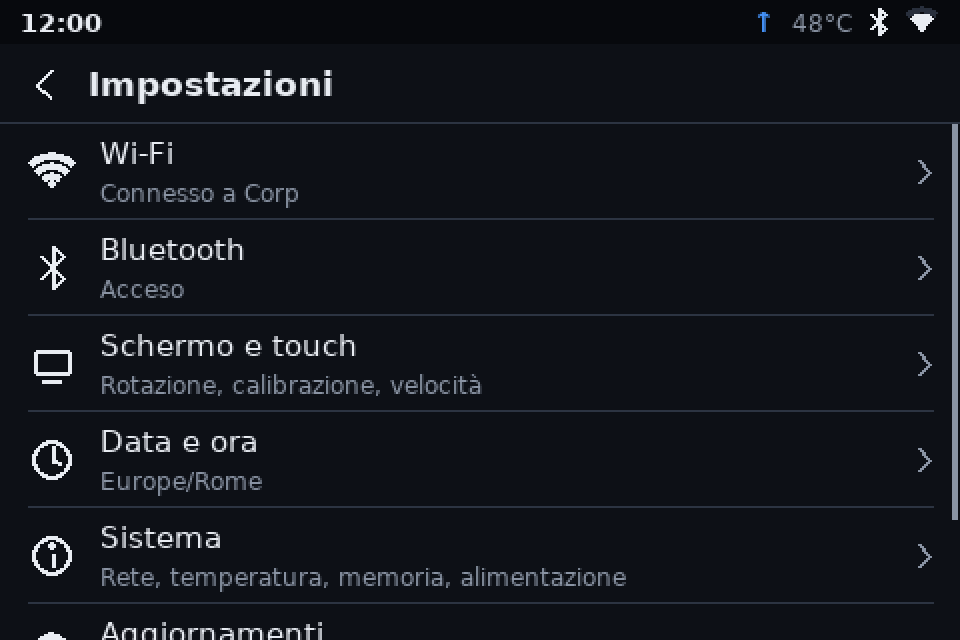
  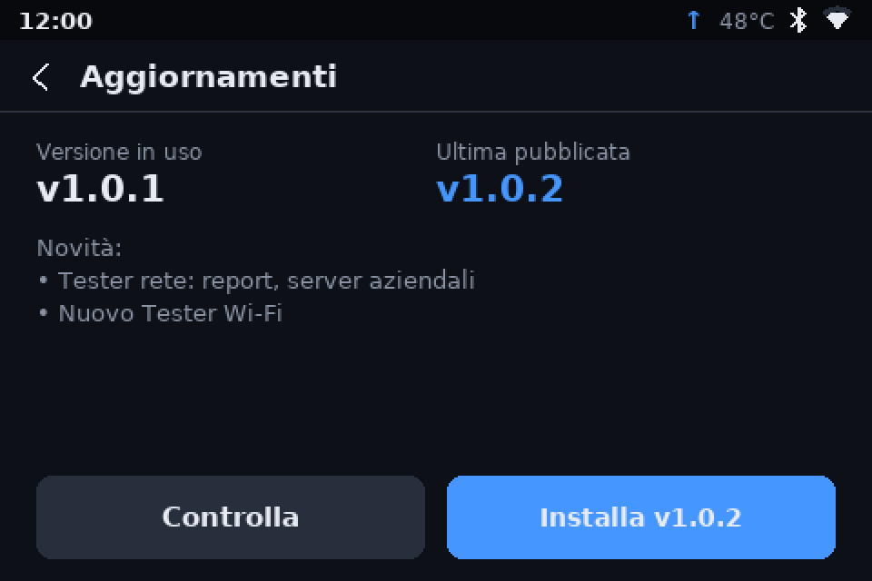
</p>

- **Wi-Fi**: scan, connect (with on-screen password entry), forget networks, show IP address.
- **Bluetooth**: power, scan, pair, connect, remove devices.
- **Schermo e touch** (screen and touch): flip the screen 180°, calibrate the touch panel, change the SPI clock.
- **Data e ora** (date and time): time zone and NTP status.
- **Sistema** (system): host name, IP addresses, temperature, load, memory, disk, uptime, under-voltage warnings.
- **Aggiornamenti** (updates): installed and latest version, release notes, one-tap install (see
  [Over-the-air updates](#over-the-air-updates)).
- **Alimentazione** (power): restart the launcher, reboot, shut down.

### Network tester

Plug a cable into the Pi's Ethernet port and the checks run by themselves, one after another, each with a
green/yellow/red indicator. Tap any row for the full details.

<p align="center">
  
  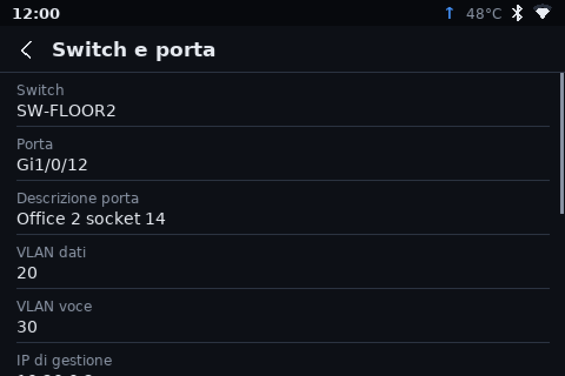
</p>

| Check | What it shows |
|---|---|
| **Cable and link** | Speed, duplex, the switch's maximum speed, CRC errors. Warns when a gigabit link comes up at 100 Mbit/s, which usually means a cable with broken pairs |
| **Switch and port** | Switch name, port, port description, data and voice VLAN, management IP, read from LLDP and CDP announcements (it listens for up to 65 s). Detects ports that require 802.1X. Spanning tree details: protocol, root bridge, path cost, topology changes |
| **IP address** | Address, gateway, DNS, domain, DHCP server, lease and how long DHCP took. Duplicate IP check (ARP probe), every DHCP server that answers (flags rogue servers), DHCP relay, option 82, NTP, TFTP for IP phones (options 66/150), WPAD, the tester's reverse DNS name, IPv6 |
| **Gateway** | Ping latency and loss, gateway MAC and vendor, MTU |
| **DNS** | Resolves an external name and the internal domain on every DNS server, finds the domain controllers (SRV records) and `wpad.<domain>` |
| **Internet** | HTTP and HTTPS reachability (tells open network, proxy/captive portal and blocked network apart), traceroute and MTU |
| **Company servers** | Reachability of servers you enter by hand (TCP ports or ping) and the clock offset against the NTP server |

When DHCP does not answer, the tester runs a **detailed DHCP test**: it sends its own DHCP requests for 12 seconds
and reports any offers, how much traffic reaches the port and whether the link dropped. That separates a dead
port from one that ignores the tester (port security, MAC-bound assignment, NAC/802.1X). It then keeps waiting,
because some corporate ports only hand out an address after one or two minutes.

<p align="center">
  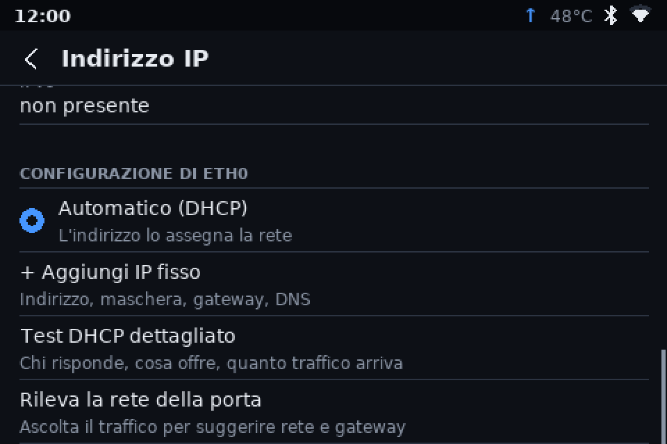
  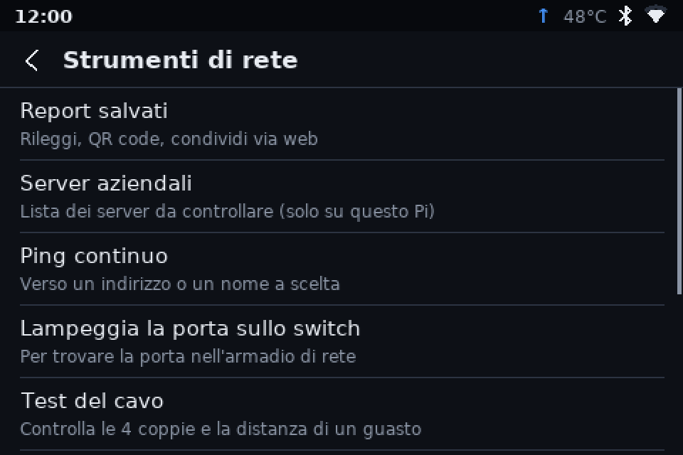
</p>

**IP configuration** (tap the IP row): switch between DHCP and saved static IP profiles (address, mask, gateway, DNS
and a note). Before using a static address the tester checks that no other device has it. *Detect the port's
network* passively listens to ARP traffic for 25 s and suggests the subnet, the gateway, the addresses in use and the
ones that are being looked for but not answering (often the IP of the PC that was unplugged from that socket).

**Tools**:
- **Saved reports**: read them again, show them as a QR code, or share them on a read-only web page.
- **Company servers**: the list of servers to check on every test (see below).
- **Continuous ping** to any address, with a latency graph.
- **Blink the switch port**: turns the link off and on every 1.5 s for 30 s, so the port LED in the network cabinet
  blinks and you can find the right socket.
- **Cable test** (`ethtool --cable-test`): status of the four pairs and distance to a fault, when the network chip
  supports it.
- **Renew DHCP**, **detailed DHCP test**, **resolve a name** on all DNS servers.
- **Active scans** (off until you enable them): devices on the subnet via ARP, with name and vendor, and the open
  ports among 23 common ones on a given address. They send traffic to many addresses, so use them only where you
  are allowed to.

<p align="center">
  
  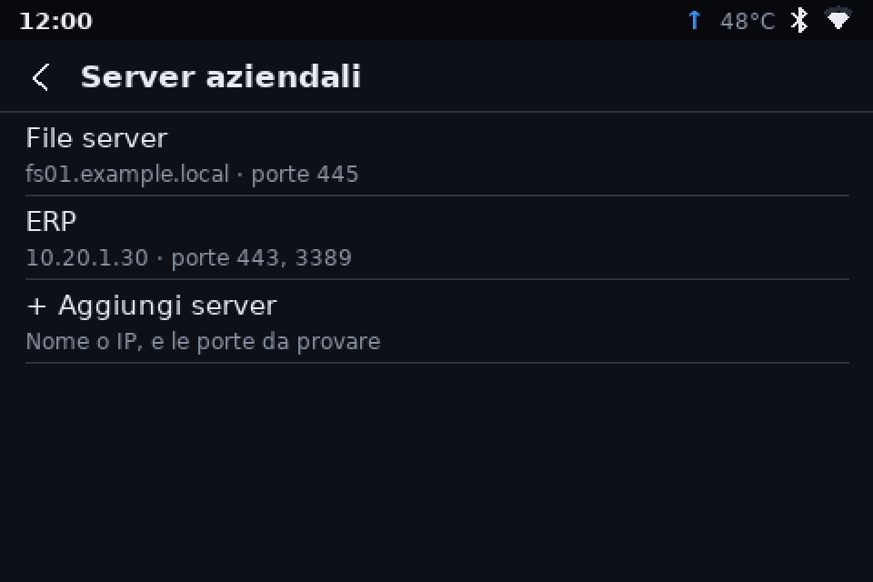
</p>

**Reports for tickets**: the *Report* button asks for the socket or office name (pre-filled from the switch port
description) and saves a plain-text report with everything collected. From there you can:
- show a **QR code** with a summary, to scan with your phone and paste into a ticket (split into pages if long);
- turn on **Share via web**, a read-only page on port 8080 with all reports, to open from a PC. It switches itself
  off after 30 minutes and is reachable from every network the Pi is connected to.

The last 200 reports are kept in `/opt/pilauncher/data/reports/`.

**Company servers**: enter name, address (IP or host name) and TCP ports of the servers to check, with the on-screen
or a USB keyboard. The list is stored **only on the Pi** (`/opt/pilauncher/data/config.json`) and never goes to GitHub.

During the automatic checks the tester listens to the switch's service traffic (LLDP, CDP, STP, 802.1X) and only
sends what a normal PC sends: DHCP, an ARP probe for its own address, ping, DNS, connections to the configured
servers and a traceroute. Port blinking and active scans must be started by hand.

### Wi-Fi tester

Uses the Pi's own Wi-Fi radio (2.4 and 5 GHz) and the `iw` command, which gives far more detail than NetworkManager.

<p align="center">
  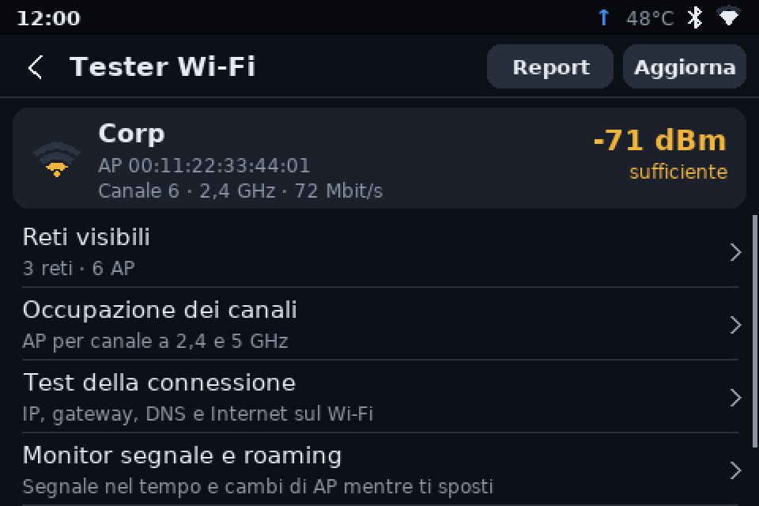
  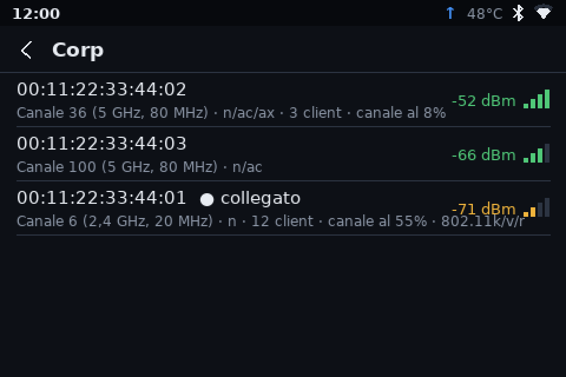
</p>

- **Current connection**: network, access point (BSSID and vendor), channel and band, signal in dBm with a rating
  (excellent ≥ -55, good ≥ -67, fair ≥ -75, poor below) and link speed.
- **Visible networks**: every network with its number of access points, bands and security. For each access point:
  signal, channel, channel width, standard (n/ac/ax), connected clients and channel utilisation (when the AP
  advertises them, as enterprise APs usually do), 802.11k/v/r fast-roaming support.
- **Channel usage**: access points per channel at 2.4 and 5 GHz.
- **Connection test**: IP, gateway, DNS and Internet over Wi-Fi.
- **Signal and roaming monitor**: signal every second, gateway ping and access point changes while you walk around.
- **Warnings**: a device stuck on a weak AP while a much stronger one of the same network is available, signal below
  -67 dBm (where voice and video start to suffer), 2.4 GHz-only networks, congested channels, 2.4 GHz APs outside
  channels 1/6/11, obsolete security.
- **Report** with QR code, like the network tester.

<p align="center">
  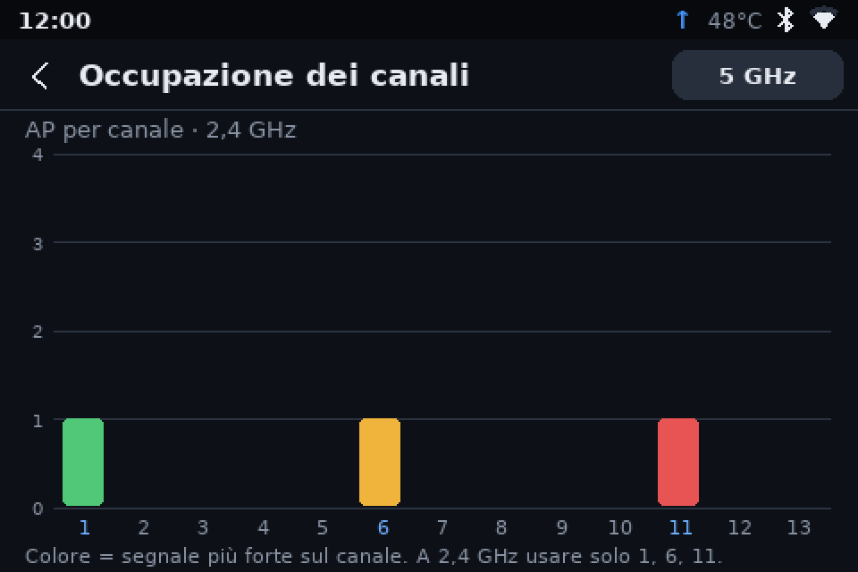
  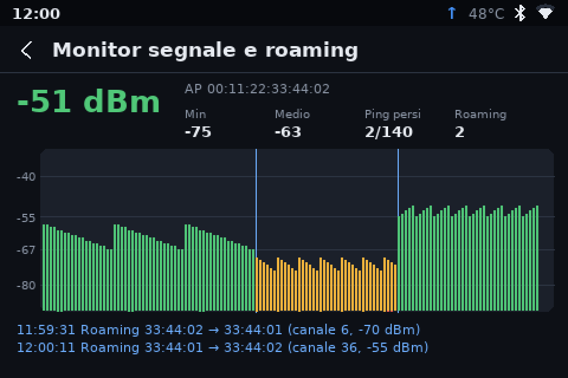
</p>

The Pi 4 radio does not see 6 GHz (Wi-Fi 6E) networks. If `iw` is missing, the app falls back to NetworkManager
with fewer details.

## Over-the-air updates

```
push to main ──► GitHub Action "Release" ──► release vX.Y.N ──► the Pi sees it ──► tap Install
```

- **Automatic releases**: every push to `main` that changes `pilauncher/` creates a release with
  `pilauncher-vX.Y.N.tar.gz` and its `.sha256` ([`release.yml`](.github/workflows/release.yml)). `X.Y` comes from
  [`pilauncher/VERSION`](pilauncher/VERSION); `N` increases by itself.
- **Checking**: the launcher asks GitHub for the latest release at start-up and every 6 hours.
- **Installing**: by hand, from Settings → Aggiornamenti → Installa. The package is downloaded, checked, compiled,
  unpacked into a new folder and activated by switching a symbolic link; then the launcher restarts.
- **Automatic rollback**: if the new version does not stay up for 30 seconds and gets restarted more than 3 times,
  [`guard.sh`](pilauncher/guard.sh) switches back to the previous version and reports it on the updates screen.

Layout on the Pi:
```
/opt/pilauncher/
├── current -> releases/v1.0.3   version in use
├── releases/                    current and previous version
├── data/                        config.json, calib.json, reports/ (kept across updates)
└── guard.sh                     run by systemd before every start
```

Updates replace only the launcher code. New system packages added to `install.sh` reach a Pi only when the
installer is run again, so the code keeps working without them.

## Useful commands

| What | Command |
|---|---|
| Live log | `journalctl -u pilauncher -f` |
| Restart the launcher | `sudo systemctl restart pilauncher` |
| Stop the launcher | `sudo systemctl stop pilauncher` |
| Installed version | `readlink /opt/pilauncher/current` |
| Recalibrate over SSH | `sudo systemctl stop pilauncher && sudo PILAUNCHER_DATA=/opt/pilauncher/data python3 /opt/pilauncher/current/main.py --calibrate` |
| Uninstall | `sudo systemctl disable --now pilauncher && sudo systemctl enable --now getty@tty1` |

## Repository layout

```
install.sh                  installer (latest release or a branch)
.github/workflows/          automatic releases
tools/screenshots.py        regenerates the README screenshots
docs/screenshots/           README images
pilauncher/
├── main.py                 main loop
├── VERSION                 version series (e.g. 1.0)
├── guard.sh                automatic rollback
├── core/
│   ├── display.py          rotation and partial writes to /dev/fb0
│   ├── touch.py            evdev input, calibration, gestures
│   ├── calibrate.py        5-point calibration
│   ├── framework.py        screens, navigation, status bar, dialogs, background tasks
│   ├── ui.py               theme, fonts, vector icons, Button, Toggle, ListView
│   ├── keyboard.py         on-screen keyboard
│   ├── usbkbd.py           USB/Bluetooth keyboards (Italian layout)
│   ├── system.py           Wi-Fi, Bluetooth, date/time, system info, power
│   ├── updater.py          over-the-air updates
│   ├── netdiag.py          wired diagnostics (link, LLDP/CDP/STP, 802.1X, DHCP, ARP, ping, DNS, TCP, NTP, HTTP)
│   ├── wifidiag.py         Wi-Fi diagnostics (iw scan, link, analysis)
│   ├── qr.py               dependency-free QR code generator
│   ├── webshare.py         read-only web page for reports
│   └── home.py             home screen and app discovery
└── apps/
    ├── settings.py         Settings
    ├── nettest/            Network tester (checks, IP config, tools, reports, servers, active scans)
    └── wifitest/           Wi-Fi tester
```

## Writing an app

Any module or package in `pilauncher/apps/` that defines an `APP` dictionary shows up on the home screen:
```python
from core.framework import Screen
from core.ui import text, icon_info

class Hello(Screen):
    title = "Hello"

    def draw_content(self, s):
        text(s, "Hello!", self.body.center, 24, anchor="center")

APP = {"name": "Hello", "icon": icon_info, "color": (40, 120, 200), "order": 10, "screen": Hello}
```

Things to know:
- The logical surface is 480×320. `self.body` is the area below the status bar and the header.
- The screen is redrawn only when `mgr.dirty` is true. Touches set it automatically; for animations set it yourself.
- Prefer small updates to full-screen animation: the SPI panel does about 6 full frames per second.
- Run slow work (network, system commands) with `self.mgr.run(function, on_done, "Message…")`, which runs it in a
  thread and shows a progress indicator.
- `self.mgr.toast("…")` shows a notice, `self.mgr.confirm(...)` a confirmation dialog.
- Physical keyboards arrive in `on_key(kind, value)`, with `kind` either `"char"` or `"key"`.

Development flow: work on a branch, try it on the Pi with `install.sh --branch`, then merge to `main`. The merge
creates a release and every Pi gets it as an update.

To refresh the screenshots after changing the UI:
```bash
python3 tools/screenshots.py
```

## License

See [LICENSE](LICENSE).
